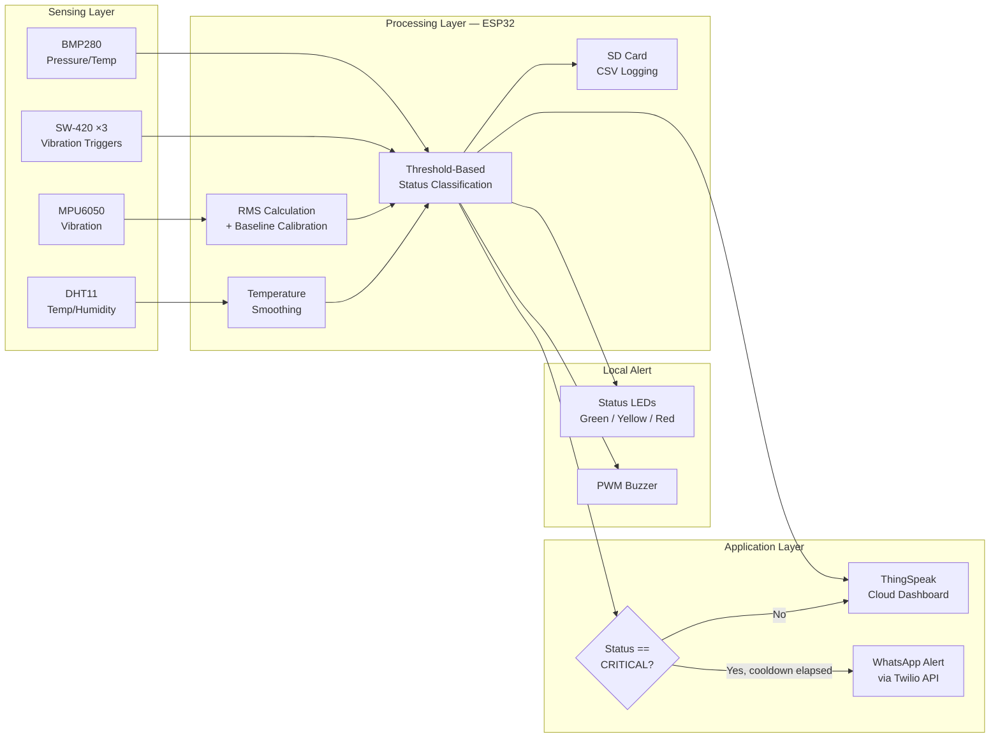
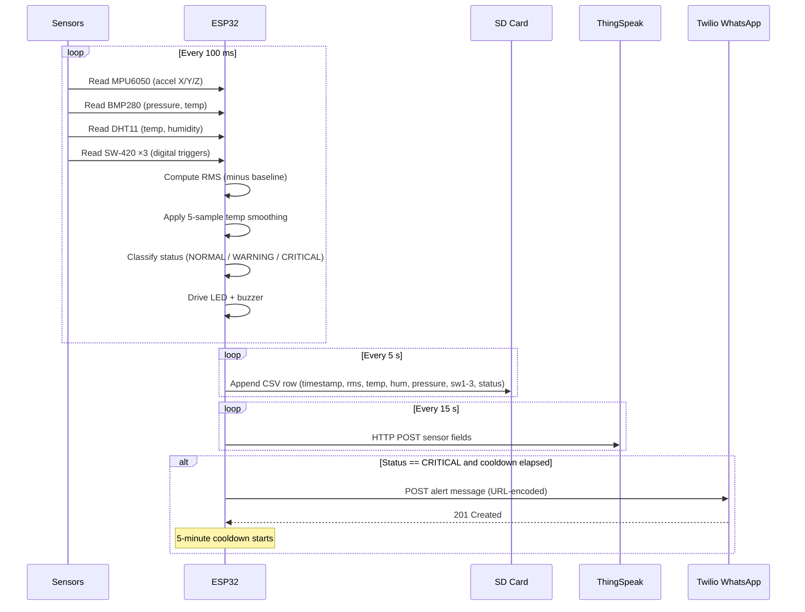
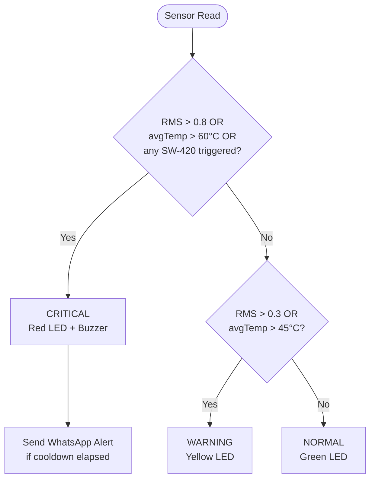

# IoT-Based Vibration and Temperature Monitoring System for Predictive Maintenance

An affordable, ESP32-based predictive maintenance system that monitors vibration, temperature, pressure, and humidity on industrial machinery in real time. It detects abnormal mechanical and thermal conditions, logs data locally and to the cloud, and issues immediate local and remote alerts — enabling predictive rather than reactive maintenance.

**Team:** Adarsh Tripathi (23BCE0981), Saksham Thakur (23BCE0932)
**Course:** BCSE497J – Project I

---

## Table of Contents

- [Overview](#overview)
- [Hardware Components](#hardware-components)
- [Software Components](#software-components)
- [System Architecture](#system-architecture)
- [Data Pipeline](#data-pipeline)
- [Pin Mapping](#pin-mapping)
- [Status Logic](#status-logic)
- [Setup Instructions](#setup-instructions)
- [Repository Structure](#repository-structure)

---

## Overview

Unexpected machinery breakdowns cause significant production losses. Commercial predictive maintenance systems are often cost-prohibitive for small and medium-scale industries. This project builds a low-cost alternative using an ESP32 microcontroller integrated with multiple sensor modalities to correlate vibration, temperature, pressure, and humidity data for accurate fault detection — combining local alerting, local data logging, cloud dashboards, and multi-channel remote notification in a single affordable unit.

---

## Hardware Components

| Component | Purpose | Interface |
|---|---|---|
| **ESP32 DevKit (38-pin)** | Central microcontroller — WiFi, processing, control | — |
| **MPU6050** | 6-axis accelerometer/gyroscope for vibration (RMS) analysis | I2C (addr `0x68`) |
| **BMP280** | Barometric pressure and temperature sensor | I2C (addr `0x76`) |
| **DHT11** | Temperature and humidity sensor | Digital (1-wire) |
| **SW-420 ×3** | Digital vibration trigger sensors — motor housing, bearing mount, shaft coupling | Digital I/O |
| **Micro SD Card Module** | Local CSV data logging | SPI |
| **Passive Buzzer** | Local audible critical alert (PWM-driven) | Digital (PWM) |
| **LEDs (Green / Yellow / Red)** | Local visual status indicator | Digital O/P + 220Ω resistors |
| **5V/2A Power Supply** | Field deployment power (USB-C for development) | VIN |

---

## Software Components

| Layer | Technology |
|---|---|
| Firmware | Arduino C++ (ESP32 core) |
| Sensor libraries | Adafruit MPU6050, Adafruit BMP280, Adafruit Unified Sensor, DHT sensor library |
| Local storage | SD library (SPI, CSV format) |
| Cloud dashboard | ThingSpeak (HTTP POST, 4 data fields) |
| Remote alerting | Twilio WhatsApp API (HTTPClient, URL-encoded REST calls) |
| Simulation/validation | Wokwi (ESP32 + MPU6050 + DHT22 + pushbuttons + LEDs + buzzer) |

---

## System Architecture

The system follows a four-layer pipeline: **Sensing → Processing → Local Alert → Application (Cloud + Remote Alert)**.



---

## Data Pipeline

End-to-end flow of a single sensor read cycle, from acquisition to alert dispatch.



---

## Pin Mapping

| Component | Signal | ESP32 Pin |
|---|---|---|
| MPU6050 / BMP280 | SDA | D21 |
| MPU6050 / BMP280 | SCL | D22 |
| MPU6050 | ADO | GND (→ addr `0x68`) |
| BMP280 | SDO | GND (→ addr `0x76`) |
| BMP280 | CSB | 3V3 (forces I2C mode) |
| DHT11 | DATA | D4 |
| SW-420 #1 (motor housing) | DO | D34 |
| SW-420 #2 (bearing mount) | DO | D35 |
| SW-420 #3 (shaft coupling) | DO | D32 |
| SD Card | CS | D5 |
| SD Card | SCK | D18 |
| SD Card | MOSI | D23 |
| SD Card | MISO | D19 |
| Buzzer | + | D25 |
| LED Green | Anode | D13 (220Ω) |
| LED Yellow | Anode | D26 (220Ω) |
| LED Red | Anode | D14 (220Ω) |
| Power | VIN | 5V adapter / USB-C |

All sensor VCC lines run on **3V3** (never VIN — all modules are 3.3V logic). Both GND pins on the ESP32 are equivalent and can be used interchangeably.

---

## Status Logic



| Status | Condition | Local Response | Remote Response |
|---|---|---|---|
| **NORMAL** | All readings below warning thresholds | Green LED | — |
| **WARNING** | RMS > 0.3 mm/s or avg. temp > 45°C | Yellow LED | — |
| **CRITICAL** | RMS > 0.8 mm/s or avg. temp > 60°C or any SW-420 triggered | Red LED + buzzer (1000 Hz tone) | WhatsApp alert (5-min cooldown) |

---

## Setup Instructions

1. **Install Arduino IDE 2.x** and add the ESP32 board package:
   ```
   https://raw.githubusercontent.com/espressif/arduino-esp32/gh-pages/package_esp32_index.json
   ```
2. **Install libraries** via Tools → Manage Libraries: `Adafruit MPU6050`, `Adafruit BMP280`, `Adafruit Unified Sensor`, `DHT sensor library`, `ThingSpeak`.
3. **Select board:** Tools → Board → ESP32 Dev Module.
4. **Wire the hardware** per the [Pin Mapping](#pin-mapping) table above.
5. **Configure credentials** in the sketch: WiFi SSID/password, ThingSpeak Channel ID + Write API Key, Twilio Account SID/Auth Token and WhatsApp numbers.
6. **Format the SD card as FAT32** (32 GB or smaller).
7. **Activate the Twilio WhatsApp sandbox** by sending `join <your-keyword>` from your WhatsApp to the sandbox number.
8. **Upload** the sketch, then open Serial Monitor at **115200 baud** to verify sensor initialization and live readings.

---

## Repository Structure

```
.
├── sketch/
│   └── iot_predictive_maintenance.ino   # Main firmware
├── wokwi/
│   ├── diagram.json                     # Wokwi simulation wiring
│   └── sketch.ino                       # Simulation-adapted firmware
├── docs/
│   └── architecture-diagram.png         # Block diagram (from project report)
└── README.md
```
